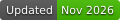

# config-macOS <!-- omit from toc -->
My essential app and system settings pack to boost productivity on macOS.

  

![Open-Source Software][OSS Icon] **open source**, click to open the repo;\
![App Store][app-store Icon] **App Store** link;\
![Paid][Paid Icon] I use the **paid version**;\
![Recommended][Recommended Icon] **highly recommended**.

## Contents <!-- omit from toc -->
- [Windows \& Display](#windows--display)
- [Menu Bar](#menu-bar)
- [Productivity](#productivity)
- [System \& Hardware](#system--hardware)
- [AI \& Development](#ai--development)
- [Network \& Browsers](#network--browsers)
- [System Tweaks](#system-tweaks)

## Windows & Display
- [AltTab](https://alt-tab.app) - Windows-style Alt-Tab for macOS. (`Note:` v11 introduced a Pro version; I highly recommend staying on v10. The binary was removed from the repo, but you can get it from the Nix package cache [here](https://github.com/user-attachments/files/28276128/AltTab-10.12.0.zip).) [![Open-Source Software][OSS Icon]](https://github.com/lwouis/alt-tab-macos) ![Recommended][Recommended Icon]
- [BetterDisplay](https://betterdisplay.pro) - Extremely powerful tool to unlock the full potential of your displays. [![Open-Source Software][OSS Icon]](https://github.com/waydabber/betterdisplay) ![Paid][Paid Icon] ![Recommended][Recommended Icon]
- [Rectangle](https://rectangleapp.com) - Move and resize windows using keyboard shortcuts. [![Open-Source Software][OSS Icon]](https://github.com/rxhanson/Rectangle)
- [TopNotch](https://topnotch.app) - Hides the notch, making the menu bar uniform.

## Menu Bar
- [boringNotch](https://theboring.name) - Brings your notch to life with dynamic status, music controls, calendar, and much more. [![Open-Source Software][OSS Icon]](https://github.com/TheBoredTeam/boring.notch)
- [MacMute](https://tuanbt.github.io/MacMute/) - Mute your microphone system-wide with one global shortcut, no need to find the meeting window. [![Open-Source Software][OSS Icon]](https://github.com/TuanBT/MacMute)
- [Quick Note](https://apps.apple.com/pt/app/quick-note-sticky-notes-menu/id1472935217?l=en-GB&mt=12) - Notes that live in the menu bar, easy to access and manage. [![App Store Software][app-store Icon]](https://apps.apple.com/pt/app/quick-note-sticky-notes-menu/id1472935217?l=en-GB&mt=12)
- [Stats](https://mac-stats.com) - Real-time system stats in the menu bar: CPU, RAM, fan speed, power usage, etc. [![Open-Source Software][OSS Icon]](https://github.com/exelban/stats)
- [Thaw](https://github.com/stonerl/Thaw) - Menu bar manager that groups apps and keeps it clean, supporting the newest macOS versions. [![Open-Source Software][OSS Icon]](https://github.com/stonerl/Thaw) ![Recommended][Recommended Icon]

## Productivity
- [Caffeine](https://www.caffeine-app.net) - Keeps your Mac awake; useful nowadays when running an agent. [![Open-Source Software][OSS Icon]](https://github.com/domzilla/Caffeine)
- [Cap](https://cap.so) - Screen recorder with an integrated editor, excellent for quick edits and software demo videos. [![Open-Source Software][OSS Icon]](https://github.com/CapSoftware/cap)
- [Clipy](https://clipy-app.com) - Clipboard history, restore anything you copied before. [![Open-Source Software][OSS Icon]](https://github.com/clipy/clipy) ![Recommended][Recommended Icon]
- [Grab2Text](https://www.softwarehow.com/grab2text/) - Copy text from images or any document using OCR. ![Recommended][Recommended Icon]
- [Shottr](https://shottr.cc) - A better-than-native screenshot tool. ![Recommended][Recommended Icon]

## System & Hardware
- [AlDente](https://apphousekitchen.com) - Full control over your MacBook battery; set charge limits to prolong battery lifespan. [![Open-Source Software][OSS Icon]](https://github.com/AppHouseKitchen/AlDente-Charge-Limiter) ![Recommended][Recommended Icon]
- [KeyboardCleanTool](https://folivora.ai/keyboardcleantool) - Super simple tool that blocks all keyboard and Touch Bar input while you clean.
- [Mac Mouse Fix](https://macmousefix.com/en/) - Simply the best mouse software for Mac, turning any regular mouse into a Logitech MX Master or Apple Trackpad. [![Open-Source Software][OSS Icon]](https://github.com/noah-nuebling/mac-mouse-fix) ![Paid][Paid Icon] ![Recommended][Recommended Icon]
- [Macs Fan Control](https://crystalidea.com/macs-fan-control) - Monitor and control your Mac's fan speed as you please.

## AI & Development
- [claude-usage](https://github.com/phuryn/claude-usage) - Local dashboard (CLI + web) to track Claude Code token usage, costs, and session history. [![Open-Source Software][OSS Icon]](https://github.com/phuryn/claude-usage)
- [LM Studio](https://lmstudio.ai) - Discover, download, and run LLMs locally. Very easy to use and connects to other devices via LM Link. Learn more [here](https://277477.xyz/journal/claude-nvidia/).

## Network & Browsers
- [Arc](https://arc.net) - Apple-style browser with a very modern UI. It used to be my main browser, but I ran into video playback issues and switched to Vivaldi.
- [Tailscale](https://tailscale.com) - Zero-config peer-to-peer VPN; very useful for accessing my home server from anywhere. [![Open-Source Software][OSS Icon]](https://github.com/tailscale/tailscale)
- [Vivaldi](https://vivaldi.com) - Chromium-based browser. I don't know why I like it, but I've never had any issues with it.

---

## System Tweaks
- [Dock Speed](tweaks/dock-speed.md) - Make the Dock reappear instantly (or faster) when auto-hidden. ![Recommended][Recommended Icon]
- [Fast Space Shift](tweaks/fast-space-shift.md) - Remove the slow animation when switching between Spaces, using yabai + skhd.

## License <!-- omit from toc -->
This project is licensed under the [MIT License](LICENSE).

[OSS Icon]: svg/min-oss.svg "Open Source Software"
[Paid Icon]: svg/min-paid.svg "Paid Software"
[app-store Icon]: svg/min-app-store.svg "App Store Software"
[Recommended Icon]: svg/min-recommended.svg "Recommended"
